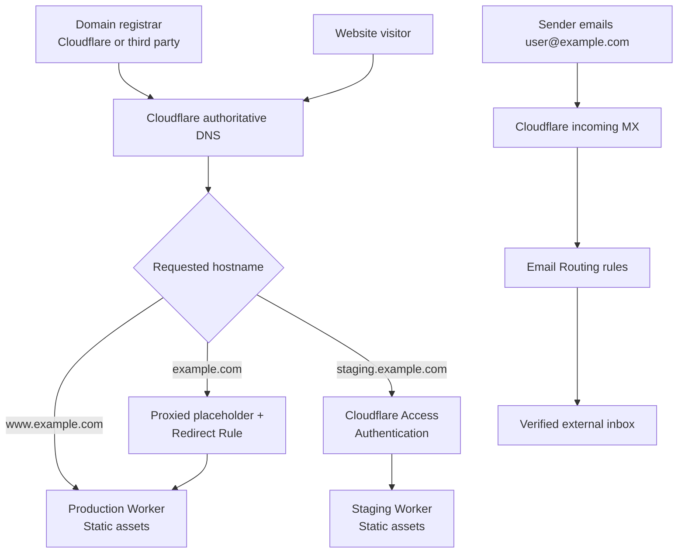
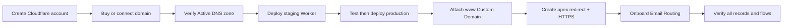
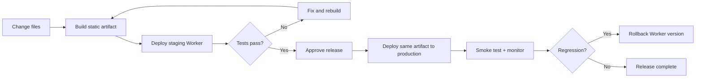

# Cloudflare Domain, Workers Hosting, DNS & Email

**A complete theoretical setup and operations guide**  
**Edition:** 1.0  |  **Documentation reviewed:** 10 November 2026  |  **Scope:** New domain, static site, staging, production, HTTPS, DNS, inbound email, optional outbound email

> **Important:** This is a reference procedure, not a record of a live deployment. `example.com` is the reserved illustrative domain used throughout. Replace it, the Worker names, and example inboxes with your own values. Dashboard labels and account entitlements can change; confirm each setting before saving it. No domain purchase, DNS change, deployment, payment, or email delivery test was performed for this document.

## Contents

1. [Executive overview](#1-executive-overview)
2. [Architecture and request flow](#2-architecture-and-request-flow)
3. [Prerequisites and decisions](#3-prerequisites-and-decisions)
4. [Register a domain: two routes](#4-register-a-domain-two-routes)
5. [Activate Cloudflare authoritative DNS](#5-activate-cloudflare-authoritative-dns)
6. [Prepare and deploy the website](#6-prepare-and-deploy-the-website)
7. [Staging, production, and access protection](#7-staging-production-and-access-protection)
8. [Attach the production custom domain](#8-attach-the-production-custom-domain)
9. [Create the root-domain redirect](#9-create-the-root-domain-redirect)
10. [Configure HTTPS and DNSSEC](#10-configure-https-and-dnssec)
11. [Set up incoming email forwarding](#11-set-up-incoming-email-forwarding)
12. [SPF, DKIM, and DMARC](#12-spf-dkim-and-dmarc)
13. [Outbound email and full mailbox alternatives](#13-outbound-email-and-full-mailbox-alternatives)
14. [Complete DNS inventory](#14-complete-dns-inventory)
15. [Validation and acceptance tests](#15-validation-and-acceptance-tests)
16. [Release workflow and recovery](#16-release-workflow-and-recovery)
17. [Security, limits, and operations](#17-security-limits-and-operations)
18. [Troubleshooting and failure isolation](#18-troubleshooting-and-failure-isolation)
19. [End-to-end completion checklist](#19-end-to-end-completion-checklist)
20. [Glossary and official references](#20-glossary-and-official-references)

---

## 1. Executive overview

### 1.1 Objective

A domain registration is the right to use a name; it is not web hosting or a mailbox. This guide builds a static website and inbound email service without buying a shared-hosting package or a VPS. Cloudflare supplies authoritative DNS, a global HTTPS edge, Workers Static Assets, redirect rules, and inbound Email Routing. A registrar still collects registration/renewal fees; optional sending and mailbox services can cost extra.

**Resulting reference configuration**

| Need | Illustrative value | Responsible service |
|---|---|---|
| Purchased domain | `example.com` | Cloudflare Registrar or another registrar |
| Canonical production website | `https://www.example.com` | Production Worker Custom Domain |
| Root domain | `https://example.com` redirects to `www` | Proxied placeholder A record + Redirect Rule |
| Production deployment | `example-production` | Workers Static Assets |
| Staging deployment | `example-staging` | Separate Worker |
| Optional private staging URL | `https://staging.example.com` | Staging Custom Domain + Cloudflare Access |
| Incoming email | `support@`, `contact@`, `info@`, `admin@` + `example.com` | Cloudflare Email Routing |
| Email destination | Existing verified Gmail/Outlook/other inbox | Destination mailbox provider |
| Outgoing email | Optional, not included in forwarding | Cloudflare Email Sending or external provider |

### 1.2 What this does not provide

Cloudflare Workers Static Assets is not PHP shared hosting, a traditional cPanel account, a Windows server, or a general-purpose virtual machine. Uploading a WordPress/PHP application does not make it run as a static site. Cloudflare Email Routing forwards inbound mail; it does **not** create inbox storage, a webmail account, or a general-purpose SMTP sender. If the site requires a database, authenticated back end, server-side rendering, or online store functionality, design those additional services separately.

### 1.3 Operating principles

1. Keep website DNS in the same Cloudflare account as the Workers that own Custom Domains.
2. Never guess DNS verification tokens, MX priorities, public keys, or assigned nameservers.
3. Prefer distinct staging and production Workers; promote known, tested build output.
4. Let Cloudflare own records created for Worker Custom Domains and Email Routing.
5. Treat the registrar, DNS, web deployment, and email routing as separate failure domains.
6. Make changes incrementally and retain a record of the pre-change state.

## 2. Architecture and request flow

### 2.1 Overall architecture



The diagram is conceptual: DNS looks up hostnames, HTTP traffic reaches Cloudflare's edge, and SMTP traffic reaches Cloudflare's mail exchangers. DNS itself does not forward email messages or serve web pages.

### 2.2 The configuration workflow



**Go/no-go gates:** do not attach production before staging passes; do not change existing inbound MX records before deciding on an email migration; do not enable HSTS or strict DMARC enforcement before complete verification.

## 3. Prerequisites and decisions

### 3.1 What you need

- A Cloudflare account with a verified login email and MFA/2FA enabled.
- The ability to register a domain and pay its registration/renewal fees.
- Access to the registrar's nameserver and DNSSEC/DS settings if the domain was bought elsewhere.
- A website folder or the build output of a front-end framework, including `index.html`.
- An existing mailbox that can receive Cloudflare's destination-verification message.
- Optional: a workstation with supported Node.js and Wrangler for reproducible CLI deployments.

### 3.2 Choose a domain path

| If... | Recommended action |
|---|---|
| You own no domain | Register through Cloudflare Registrar (if available) or another registrar. |
| You bought the domain at Cloudflare | Cloudflare nameservers are already used; inspect the zone and proceed. |
| You bought it elsewhere and do not use existing services | Add it to Cloudflare and change authoritative nameservers at the registrar. |
| You bought it elsewhere and already use email or a website | Inventory records and plan cutover **before** changing nameservers or MX records. |

### 3.3 Choose an email path **before** onboarding

| Requirement | Choose | Important constraint |
|---|---|---|
| Receive `support@...` and forward to Gmail/Outlook | **Cloudflare Email Routing** | Inbound only; no independent mailbox or general sending. |
| Send transactional email from an app | **Cloudflare Email Sending** or another sender | Separate sending service and authentication; prices and eligibility apply. |
| Have a real `support@...` inbox, folders, webmail and replies | **Hosted mailbox provider** | Use that provider's incoming MX records, not Cloudflare Email Routing MX at the same domain. |

## 4. Register a domain: two routes

### 4.1 Option A — Buy through Cloudflare Registrar

1. Visit [Cloudflare Dashboard](https://dash.cloudflare.com/) and create/sign in to your account.
2. Open **Domain Registration → Register Domains** (the interface may also say **Register domains**).
3. Search the desired name and top-level domain (for example `.com`, `.org`, `.net`).
4. Check availability, registration and renewal prices, restrictions, and supported extensions.
5. Select **Purchase**, choose the registration term, and supply accurate registrant contact information.
6. Review terms, checkout and payment; complete any required email/registrant verification.
7. Open **Domain Registration → Manage Domains** and confirm ownership, expiration date, auto-renewal, and lock/security status.
8. Open the new domain's DNS zone. Cloudflare Registrar domains automatically use Cloudflare authoritative nameservers; **do not change them at a separate registrar**.

**Before purchase:** Cloudflare Registrar does not support every extension or internationalized domain spelling. Check both availability and transfer/renewal rules before committing. Cloudflare Registrar requires Cloudflare authoritative DNS. [CF-01]

### 4.2 Option B — Buy through another registrar

1. Register the domain with your preferred registrar, pay and verify contact information.
2. In Cloudflare Dashboard, select **Domains → Onboard a domain / Add a domain**.
3. Enter the **apex name** `example.com`, not `www.example.com`; select the available plan (Free is sufficient for this reference configuration).
4. Review Cloudflare's detected DNS records. Its scan may be incomplete: manually compare existing A, AAAA, CNAME, MX, TXT, SRV, CAA, and relevant subdomain records with the current DNS provider.
5. Cloudflare shows **two assigned nameservers**. Copy the exact values; they look like `<assigned>.ns.cloudflare.com` but are different for each zone.
6. Before delegation, if an old DNSSEC DS record exists at the registrar, perform the documented DNSSEC migration and remove stale DS records at the registrar to prevent validation failures.
7. At your registrar, locate **Nameservers / Custom nameservers**; replace all previous authoritative nameservers with exactly the two assigned by Cloudflare.
8. Save and return to Cloudflare. The zone may temporarily show **Pending Nameserver Update**. Confirm it becomes **Active** before proceeding.
9. Compare all needed records again in the Active Cloudflare zone. Switching nameservers changes **who answers DNS**, not ownership of the domain registration.

**Do not:** insert Cloudflare's assigned nameservers as ordinary NS records inside the root zone's DNS Records page. For a normal full setup, delegation is made **at the registrar**. [CF-02]

### 4.3 Nameserver migration checklist

- [ ] Domain registration is valid and contact email verified.
- [ ] Existing website/mail records are exported or copied.
- [ ] Old DNSSEC DS record is handled before the cutover.
- [ ] Exactly the assigned Cloudflare nameservers are registered.
- [ ] Cloudflare zone becomes Active.
- [ ] Existing mail service still resolves and receives mail, if one was present.

## 5. Activate Cloudflare authoritative DNS

### 5.1 Identify which records are needed

Open **Cloudflare Dashboard → Domains → example.com → DNS → Records**. The reference design needs only one manually created website A record (for the root redirect) plus a manually managed DMARC TXT record. Cloudflare manages the production/staging Worker Custom Domain records, and Email Routing adds its MX/SPF/DKIM records.

| Record | Function | Necessary here? |
|---|---|---|
| `A` / `AAAA` | Maps hostname to an IP address | Only a proxied **apex placeholder A** for this design. |
| `CNAME` | Alias to a hostname | Not manually required for a Worker Custom Domain. |
| `MX` | Advertises inbound mail exchangers | Yes if using Email Routing; Cloudflare creates them. |
| `TXT` | Verification and SPF/DKIM/DMARC | SPF/DKIM managed by Cloudflare; DMARC can be added manually. |
| `NS` | Nameserver delegation | Registrar delegation; additional NS only for special subdomain delegation. |
| `CAA` | Limits certificate authorities | Optional; incorrect values may block certificates. |
| `SRV` | Service discovery | Not needed for this static site. |
| `DS` | DNSSEC chain of trust | Published at registrar/parent; not an ordinary website A record. |

### 5.2 Proxy status rules

- **Orange cloud / Proxied:** Use for Cloudflare-served HTTP/HTTPS traffic and for the apex placeholder that triggers the Redirect Rule.
- **Gray cloud / DNS only:** Typical for external email and verification DNS, when proxy does not apply. MX, TXT, NS and related record types are not Cloudflare HTTP-proxied.
- **Worker-managed:** Do not manually create a competing `www` A or CNAME when attaching the production Worker via **Custom Domain**.

**Do not confuse DNS and hosting.** A DNS record does not create a web server, an email mailbox, or an SSL certificate by itself.

## 6. Prepare and deploy the website

### 6.1 Prepare the site

For a plain static site, prepare files similar to:

```text
site/
└── public/
    ├── index.html
    ├── 404.html
    ├── about.html
    ├── contact.html
    ├── css/
    │   └── styles.css
    ├── js/
    │   └── app.js
    └── images/
        └── logo.svg
```

If using React, Vue, Svelte, or another framework, build it and identify the generated `dist`, `build`, or `public` output **appropriate to that framework**. Do not upload secrets, `.env`, `.git`, uncompiled source intended for private use, or credentials. Workers Static Assets hosts the published browser files; a dynamic backend needs a separate design. The legacy **Workers Sites** mechanism is deprecated for new projects; use **Workers Static Assets**. [CF-03]

### 6.2 Recommended reproducible deployment path (Wrangler)

Wrangler provides exact Worker names and repeatable staging/production releases. On a workstation with supported Node.js and npm, sign in and verify the account:

```powershell
npx wrangler login
npx wrangler whoami
```

Save two illustrative configuration files alongside `public/` in the hypothetical project. These samples describe **assets-only Workers**, so no `main` script is required.

**`wrangler.staging.jsonc`**

```json
{
  "name": "example-staging",
  "compatibility_date": "2026-11-10",
  "assets": { "directory": "./public" }
}
```

**`wrangler.production.jsonc`**

```json
{
  "name": "example-production",
  "compatibility_date": "2026-11-10",
  "assets": { "directory": "./public" }
}
```

Deploy the staging release first:

```powershell
npx wrangler deploy --config wrangler.staging.jsonc
```

After staging acceptance tests, deploy the **same approved artifact** to production:

```powershell
npx wrangler deploy --config wrangler.production.jsonc
```

The commands perform network-authenticated changes to a Cloudflare account. They are **examples only, NOT EXECUTED**. Review the account identity, file paths, intended Worker name, and build output before using them. Current Wrangler accepts assets-only configuration and separate `--config` files. [CF-04]

### 6.3 Browser-only alternative: Cloudflare Drop

1. Open [Cloudflare Drop](https://www.cloudflare.com/drop/).
2. Upload the prepared static site folder, ZIP, or accepted website file.
3. Verify the temporary `workers.dev` preview URL and its contents.
4. Complete the **claim** flow within the indicated window (Cloudflare's temporary-account claim documentation specifies 60 minutes).
5. Inspect which Cloudflare **account** now owns the claimed Worker. This may be a claimed temporary-origin account rather than the account containing your registered domain.
6. If the Worker and domain are in different accounts, deploy the static assets again to a Worker in the account that owns the DNS zone. Do **not** assume a claim automatically moves the Worker into an existing DNS-zone account.
7. Create a separate production Worker rather than overwriting the staging preview; verify both resources independently.

**Usage recommendation:** Drop is convenient for demonstrations and initial previews. For named, versioned, repeatable production deployments, use Wrangler or an authenticated Git/CI deployment. [CF-05]

## 7. Staging, production, and access protection

### 7.1 Keep environments separate

| Environment | Worker | Public hostname | Change policy |
|---|---|---|---|
| Staging | `example-staging` | `workers.dev` or `staging.example.com` | Deploy first; test and approve. |
| Production | `example-production` | `www.example.com` | Only deploy previously approved build. |

A `workers.dev` address is generally public by default. To give staging a dedicated hostname, open the staging Worker → **Settings → Domains & Routes → Add → Custom Domain** and enter `staging.example.com`. Cloudflare manages its DNS/edge certificate automatically.

### 7.2 Restrict staging access

1. Open **Workers & Pages → example-staging → Access**.
2. Enable Cloudflare Zero Trust/Access if not already configured.
3. Create an access policy allowing only your approved test users or identities.
4. Prefer **Worker-level protection**, which covers the Worker's associated domains and preview URLs, so a `workers.dev` URL cannot bypass a hostname-only policy.
5. Test access from an approved user **and** an unapproved/incognito session.

If Worker-level Access is not available in the account or the design uses other access paths, review every hostname/route for bypasses. [CF-06]

### 7.3 Staging acceptance gate

Verify navigation, links, forms, static file paths, mobile layout, accessibility, browser console, expected 404 behavior, cache assumptions, and any external APIs. A contact form that sends email is **not** implemented merely by hosting a static HTML form; it requires a form endpoint/Worker and abuse controls or a third-party service.

## 8. Attach the production custom domain

After the production Worker is deployed **in the account owning the Active DNS zone**:

1. Open **Workers & Pages → example-production**.
2. Open **Settings → Domains & Routes**.
3. Select **Add → Custom Domain**.
4. Enter `www.example.com` and confirm.
5. Wait for Cloudflare to provision the hostname's DNS mapping and edge certificate.
6. Verify the Custom Domain is Active/ready, then open `https://www.example.com`.

A **Worker Custom Domain** makes the Worker the origin for the exact hostname. It is different from a Worker **Route**, which commonly places a Worker in front of an existing origin. Do not attach only `example.com` and expect `www.example.com` to work: the hostnames are distinct. [CF-07]

**Never add a manual competing `www` A or CNAME** on the assumption the Worker requires a fake origin. Cloudflare creates and maintains the DNS mapping for the Worker Custom Domain.

## 9. Create the root-domain redirect

### 9.1 Add a proxied apex placeholder

Go to **Domains → example.com → DNS → Records → Add record** and use:

| Field | Value |
|---|---|
| Type | `A` |
| Name | `@` (apex/root) |
| IPv4 address | `192.0.2.0` |
| Proxy status | **Proxied** (orange cloud) |
| TTL | Auto |

This is an **originless redirect placeholder** reserved for documentation use, not an accessible web server. Because the record is proxied, Cloudflare receives the HTTP request and can apply a redirect. If an existing apex A/AAAA/CNAME already serves something important, inventory it and plan a migration before replacement. [CF-07]

### 9.2 Create a redirect rule

1. In the domain zone, open **Rules → Overview → Create rule → Redirect Rule** (or the dashboard's current equivalent).
2. Name it `Redirect apex to www`.
3. Under **When incoming requests match**, choose **Custom filter expression**.
4. Enter the condition below.
5. Under **Then**, choose **Dynamic URL redirect**, enter the target expression below, set **301**, and enable **Preserve query string**.
6. Save/deploy the rule and test it with a browser and an HTTP client.

**Condition**

```text
(http.host eq "example.com")
```

**Dynamic target expression**

```text
concat("https://www.example.com", http.request.uri.path)
```

**Intended outcomes**

| Incoming URL | Final canonical URL |
|---|---|
| `http://example.com/` | `https://www.example.com/` |
| `https://example.com/about.html` | `https://www.example.com/about.html` |
| `https://example.com/contact.html?src=qr` | `https://www.example.com/contact.html?src=qr` |

The path is preserved by the expression and the query string by the setting. HTTP-to-HTTPS enforcement may cause a separate intermediate redirect. Do not add the reverse redirect `www → apex`, or the two rules may loop. A 301 redirect can change a POST to GET in some clients; do not use canonical host redirection as an API method-preservation mechanism without considering 307/308. [CF-08]

## 10. Configure HTTPS and DNSSEC

### 10.1 Edge certificates and HTTPS

1. In **Workers & Pages → production Worker → Domains & Routes**, verify `www.example.com` is active and covered by a certificate.
2. In **example.com → SSL/TLS → Edge Certificates**, confirm the applicable certificates are active for apex and `www`.
3. Find **Always Use HTTPS** and enable it after certificate readiness.
4. Test `http://example.com`, `https://example.com`, `http://www.example.com`, and `https://www.example.com`.
5. All four should end at `https://www.example.com`, allowing intermediate redirects.
6. **Do not enable HSTS until all relevant HTTPS hostnames work.** HSTS can persist in browsers and complicate rollback.

This is an originless Worker deployment. Do not invent an origin server or install a server certificate on an address you do not control. If you later connect an external origin, re-evaluate SSL/TLS mode and origin verification; avoid weak configurations such as Flexible for a real HTTPS origin. [CF-09]

### 10.2 DNSSEC

For a Cloudflare Registrar domain, use the registrar's **Manage Domains → Configuration → DNSSEC** controls. For a third-party registrar domain, first confirm delegation is stable and the zone is Active, then open Cloudflare **DNS → Settings → DNSSEC**. Enable DNSSEC and publish the Cloudflare-provided DS information at the registrar if the registrar does not automate it. Verify the chain of trust. A stale DS entry during a nameserver migration can cause widespread resolution failure. [CF-10]

## 11. Set up incoming email forwarding

### 11.1 Email delivery architecture

```mermaid
flowchart LR
    E[External sender] --> MX[Cloudflare MX records\nexample.com]
    MX --> R[Email Routing rules]
    R -->|support@| IN[Verified existing mailbox]
    R -->|contact@| IN
    R -->|info@| IN
    R -->|admin@| IN
    OUT[Optional outbound sender] -. separate product .-> S[Email Sending / mailbox provider]
```

**Important:** Creating a routing address is not creating a mailbox. Messages are forwarded to an existing verified destination. Replying **as** `support@example.com` is a separate outbound-service problem.

### 11.2 Onboard the domain

1. Open Cloudflare Dashboard → **Compute → Email Service → Email Routing**.
2. Select **Onboard Domain** and choose `example.com`.
3. Review the MX records and the SPF/DKIM TXT records Cloudflare proposes.
4. Confirm onboarding. This writes the necessary records to Cloudflare DNS.
5. Open **Email Routing → Settings → DNS records** and verify the records show configured.

Before approving, ensure an existing external email provider does **not** already depend on the apex MX records. Email Routing and a separate full mailbox provider should not be given competing independent apex MX sets. DNS records may take time to propagate globally. [CF-11]

### 11.3 Verify the destination address

1. Open **Compute → Email Service → Email Routing → Destination Addresses**.
2. Add an actual existing inbox, such as a personal Gmail or Outlook address that you control.
3. Open the Cloudflare verification message delivered there and follow its confirmation link.
4. Ensure the destination status is **Verified** before making forwarding rules.

### 11.4 Create four routing rules

In **Email Routing → Routing Rules → Create routing rule**, add each **local part** (the part before `@`) and select **Send to an email** with the verified destination.

| Rule name / pattern | Full address | Action | Destination |
|---|---|---|---|
| `support` | `support@example.com` | Send to an email | Verified external inbox |
| `contact` | `contact@example.com` | Send to an email | Verified external inbox |
| `info` | `info@example.com` | Send to an email | Verified external inbox |
| `admin` | `admin@example.com` | Send to an email | Verified external inbox |

1. Create `support`; save and confirm active.
2. Repeat for `contact`, `info`, and `admin`.
3. Send a separate message to each address **from an unrelated external sender**.
4. Check the destination inbox, spam folder, and Cloudflare Email Routing Activity Log.
5. Leave **Catch-all** off unless you need mail sent to every otherwise-unconfigured local part; catch-all often increases spam volume.

There are **no separate DNS records for each local part**. The same domain-level MX records receive all mail; routing rules dispatch it by recipient address. [CF-12]

## 12. SPF, DKIM, and DMARC

Email authentication has three complementary pieces. SPF authorizes envelope-sender hosts, DKIM cryptographically signs messages, and DMARC requires aligned authenticated identity and supplies a policy. They do not individually guarantee inbox delivery or prevent all spoofing.

### 12.1 SPF — managed by Email Routing

Cloudflare's documented root-domain Email Routing SPF string is:

```text
v=spf1 include:_spf.mx.cloudflare.net ~all
```

The TXT record's name is `@` / `example.com`. **Do not add it again if onboarding created it.** If additional sending providers need SPF authorization, merge mechanisms into **one** valid SPF TXT record at a hostname; two separate `v=spf1` TXT policies at the same name can produce a permerror. Confirm the service's actual DNS instructions before editing SPF. [CF-13]

### 12.2 DKIM — managed by Email Routing

Cloudflare Email Routing's documented DKIM selector is:

```text
cf2024-1._domainkey.example.com
```

The TXT value contains a **Cloudflare-generated public key**, not a copyable fixed sample. Do not type `p=...` or invent a key. Other providers may use different selectors and can coexist if configured correctly. [CF-13]

### 12.3 DMARC — add a monitoring policy

For a new domain with no verified sending setup, begin with DMARC monitoring:

| DNS field | Value |
|---|---|
| Type | `TXT` |
| Name | `_dmarc` |
| Content | `v=DMARC1; p=none` |
| TTL | Auto |

Optionally, establish a working `dmarc@example.com` destination and then add aggregate reporting:

```text
v=DMARC1; p=none; rua=mailto:dmarc@example.com
```

Only after legitimate senders are authenticating and aligning should you consider `p=quarantine`, then `p=reject`. Avoid multiple conflicting TXT DMARC records at `_dmarc`. Reports are frequently XML and may require a processing service. [CF-14]

## 13. Outbound email and full mailbox alternatives

### 13.1 Option A — Cloudflare Email Sending

Cloudflare Email Sending is distinct from Email Routing. It can send application/transactional messages via Workers, API, or authenticated SMTP. The documented SMTP endpoint is `smtp.mx.cloudflare.net` on port `465` with implicit TLS, username `api_token`, and an API token with the required Email Sending permission. Do not embed that token in public JavaScript or downloadable website files. Sending to arbitrary recipients requires the Workers Paid plan under Cloudflare's documented pricing. Check feature availability and terms before implementation. [CF-15]

To onboard: open **Compute → Email Service → Email Sending → Onboard Domain**, select the domain, approve the sending-specific authentication and bounce-processing DNS records, and verify them in **Email Sending → Settings**. Cloudflare uses separate `cf-bounce` MX/SPF and `cf-bounce._domainkey` DKIM names; these **do not replace** the apex Email Routing MX records. The sending service is **not a webmail inbox**.

### 13.2 Option B — Full hosted mailboxes

If you need real inboxes and ordinary replies (for example, four separate business mailboxes), subscribe to a mailbox provider such as Google Workspace, Microsoft 365, or Zoho Mail, and follow its domain onboarding process:

1. Add your domain to the mail provider and complete ownership verification TXT records.
2. Provision the mailboxes and users.
3. Plan the cutover, including existing messages, aliases, and backups.
4. Replace the apex incoming MX set with the provider-supplied set; **do not keep Cloudflare Email Routing MX as a competing independent set**.
5. Configure the provider's SPF, DKIM, and DMARC as directed; merge SPF authorization where appropriate.
6. Verify inbound, outbound, spam handling, calendars/clients (if applicable), and mailbox access.

Cloudflare DNS and Workers hosting may remain unchanged while email is hosted elsewhere. Do **not** copy example Google or Microsoft MX records without obtaining the actual values from the provider's administration console.

### 13.3 Email decision summary

| Feature | Email Routing | Email Sending | Hosted mailbox |
|---|---|---|---|
| Receives mail for domain | Forwards incoming | No inbound mailbox | Yes |
| Stores user inbox | No | No | Yes |
| Sends to arbitrary recipients | No | Yes, subject to plan/limits | Yes |
| Typical use | `support@` → existing inbox | App notifications | Business correspondence |
| Root-domain inbound MX | Cloudflare | Does not set inbound MX itself | Mailbox provider |

## 14. Complete DNS inventory

The inventory is **scenario-specific**. DNS records are not a shopping list: do not create every optional record automatically. Record names are shown relative to `example.com`; `@` represents the apex. The actual Cloudflare-generated values, MX priorities, DKIM public key, and hostname mappings must be taken from the account's dashboard.

### 14.1 Baseline: Workers + www canonical + Email Routing

| Type | Name | Value / destination | Proxy | Who creates it | Required? |
|---|---|---|---|---|---|
| A | `@` | `192.0.2.0` | **Proxied** | You | Yes, for apex redirect |
| Worker Custom Domain | `www` | `example-production` | Managed | Cloudflare | Yes |
| Worker Custom Domain | `staging` | `example-staging` | Managed | Cloudflare | Optional |
| MX | `@` | `route1.mx.cloudflare.net` | N/A | Email Routing | Yes for Routing |
| MX | `@` | `route2.mx.cloudflare.net` | N/A | Email Routing | Yes for Routing |
| MX | `@` | `route3.mx.cloudflare.net` | N/A | Email Routing | Yes for Routing |
| TXT | `@` | `v=spf1 include:_spf.mx.cloudflare.net ~all` | N/A | Email Routing | Yes for Routing |
| TXT | `cf2024-1._domainkey` | Account-generated DKIM public key | N/A | Email Routing | Yes for Routing |
| TXT | `_dmarc` | `v=DMARC1; p=none` | N/A | You | Strongly recommended |

**MX priorities:** use the values shown by Cloudflare during onboarding; do not invent them. Each automatically provisioned Worker Custom Domain includes DNS mapping and certificate management, but it may not appear as a plain CNAME in the UI. Never add a conflicting `www` A/CNAME manually. [CF-07] [CF-13]

### 14.2 Additional records for optional Email Sending

| Type | Name | Function | Owner |
|---|---|---|---|
| MX (multiple) | `cf-bounce` | Bounce processing | Email Sending |
| TXT | `cf-bounce` | Sending SPF | Email Sending |
| TXT | `cf-bounce._domainkey` | Sending DKIM | Email Sending |
| TXT | `_dmarc` | Single DMARC policy, if managed/proposed | Coordinate with existing DMARC |

Do not copy these record names as proof of a configured sender; activate the product and verify each actual record in Email Sending settings. [CF-13]

### 14.3 Records for other DNS services (only if needed)

| Type | Example use | Caution |
|---|---|---|
| `TXT` | Third-party domain verification | Copy exact token from issuing service. |
| `CNAME` | SaaS service alias / external app | Avoid conflicts with Worker-managed hostname. |
| `CAA` | Limit certificate issuers | Can prevent Cloudflare certificate issuance. |
| `SRV` | SIP, gaming or other service discovery | Use provider-specific host/port/priority. |
| `NS` | Delegate `sub.example.com` elsewhere | Different from apex registrar nameserver change. |
| `DS` | DNSSEC chain at registrar | Preserve matching key and digest. |

### 14.4 Common conflicting-record mistakes

- Manual `A www → 192.0.2.0` **and** a `www` Worker Custom Domain: incorrect for this design.
- `CNAME www → worker.account.workers.dev` **and** a `www` Worker Custom Domain: unnecessary and can conflict.
- `A mail → 192.0.2.0`: does **not** create a mail server.
- Duplicate SPF TXT policies at `@`: SPF can fail with `permerror`.
- MX from Cloudflare Routing **and** external mailbox provider at the same domain: mail delivery becomes unpredictable.
- Public staging route with no Access policy: staging content may leak.
- A placeholder A record set to **DNS only**: redirect rule cannot intercept it through the Cloudflare proxy.

## 15. Validation and acceptance tests

**Evidence labels:** `EXECUTED` = actually performed in the named runtime/account; `STATICALLY CHECKED` = reviewed against documents or code; `SIMULATED` = exercised in a mock/model; `NOT TESTED` = no such test occurred. This theoretical guide is **STATICALLY CHECKED** for the described platform procedures. Live account and network outcomes are **NOT TESTED**.

### 15.1 DNS commands (illustrative)

On Windows with `nslookup`:

```powershell
nslookup -type=NS example.com
nslookup -type=MX example.com
nslookup -type=TXT example.com
nslookup -type=TXT _dmarc.example.com
nslookup -type=TXT cf2024-1._domainkey.example.com
```

On a system with `dig`:

```sh
dig NS example.com
dig MX example.com
dig TXT example.com
dig TXT _dmarc.example.com
```

When `@` is a proxied A placeholder, public DNS typically returns **Cloudflare edge IPs**, not `192.0.2.0`; that is expected. A healthy DKIM lookup returns a full key, not just `p=...`.

### 15.2 HTTP redirect commands (illustrative)

```powershell
curl.exe -I https://www.example.com
curl.exe -I https://example.com/about.html?src=guide
curl.exe -IL http://example.com
```

From Linux/macOS, use `curl` instead of `curl.exe`. Verify status and `Location` headers, follow the chain, and confirm the response body and static files. A path may still return 404 if the asset does not exist; redirects do not create missing pages.

### 15.3 Acceptance test matrix

| ID | Test | Pass criterion |
|---|---|---|
| D-01 | Registrar delegation | Cloudflare-assigned NS are authoritative; zone Active. |
| D-02 | DNSSEC after activation | DS matches Cloudflare key; DNS resolves without validation failures. |
| W-01 | Staging | Correct staging content and expected asset paths load. |
| W-02 | Staging privacy | Approved identity works; unauthorized identity is denied. |
| W-03 | Production | `https://www.example.com` serves approved Worker release. |
| W-04 | Root redirect | Apex redirects to `https://www`, preserving valid paths and query strings. |
| W-05 | HTTPS | HTTP ultimately uses HTTPS; relevant certificates active. |
| W-06 | Errors | Nonexistent asset returns expected 404; no sensitive file leaks. |
| E-01 | Email DNS | MX and single valid SPF, DKIM selector, DMARC are present. |
| E-02 | Destination | Existing destination address is verified. |
| E-03 | Four routing rules | `support`, `contact`, `info`, `admin` each deliver externally originated test mail. |
| E-04 | Optional sending | External recipient receives authorized signed email; SPF/DKIM/DMARC assessed. |
| O-01 | Repeated release | Redeploying approved build does not change DNS or create duplicate Workers. |
| O-02 | Recovery | Prior deployed release can be selected/rolled back within supported limits. |

### 15.4 Negative and boundary tests

Also test incorrect hostname, missing asset, extra query parameters, unusual URL encoding, expired staging authentication, an unverified email destination, a mailbox-provider MX conflict, and a repeated deployment. Keep test emails distinguishable with unique subjects and review the Routing Activity Log and destination spam folder. Do not weaken DNSSEC or DMARC just to suppress a symptom without isolating the root cause.

## 16. Release workflow and recovery



### 16.1 Routine change procedure

1. Version the source code or archive the source/build inputs.
2. Build once and identify the exact output to be promoted.
3. Deploy to `example-staging`, verify it is the intended account and Worker.
4. Run functional, security, and compatibility tests; obtain approval.
5. Deploy that approved build to `example-production`.
6. Smoke-test `www.example.com`, root redirect, key assets, and any form/API integration.
7. Record deployment ID, date, author, and change summary.
8. Monitor error rates and traffic, and retain the previous known-good release.

### 16.2 Recovery and rollback

Use **Workers & Pages → Worker → Deployments** to inspect versions and use the supported rollback control to restore a prior Worker release. Rolling back a Worker may **not** revert DNS changes, Email Routing changes, database schema/data, external APIs, or third-party storage. Plan recovery for each component separately. [CF-16]

**Change safety:** Do not remove records as a blanket reset. Before a DNS/email migration, export or screenshot prior settings, lower TTL only where supported and useful, schedule a rollback window, and ensure the previous destination can receive mail if the cutover must be reversed.

## 17. Security, limits, and operations

### 17.1 Minimum hardening

| Control | Suggested action |
|---|---|
| Identity | Enable Cloudflare account 2FA; use least-privilege roles and API tokens. |
| Domain ownership | Verify registrant email and auto-renewal; monitor expiration. |
| DNS | Audit existing records; enable DNSSEC after proper delegation. |
| TLS | Use HTTPS; enable Always Use HTTPS after certificate checks. |
| Staging | Use Worker-level Access and test all alternate entry paths. |
| Website | Never publish secrets or private config in static assets. |
| Headers | Consider CSP, HSTS (only after validation), X-Content-Type-Options, referrer policy. |
| Email | Use SPF/DKIM/DMARC, verified destinations, and least-privilege sending tokens. |
| Monitoring | Inspect Worker deployments/logs, DNS health, and Email Routing Activity Log. |
| Backups | Keep original files, build output, release notes, and DNS change history. |

### 17.2 Usage and costs

- Domain registration and renewal are paid (price depends on registrar/extension).
- Cloudflare's Free tier can be suitable for a basic static website, with platform and account limits.
- Requests to Workers Static Assets are documented as free/unlimited, while Worker **script** execution has separate plan quotas; optional features may be charged. [CF-17]
- Cloudflare Email Routing offers free inbound forwarding; outbound sending to arbitrary recipients depends on a paid plan and service limits. [CF-18]
- Confirm current limits before large traffic, large files, video range requests, transactional email, or dynamic workloads. Static assets are not unlimited storage for every imaginable use case.

### 17.3 Operational responsibilities

A site without traditional hosting still needs domain renewal, content updates, credential handling, security review, email-delivery testing, and release rollback planning. If you add a database, payments, authentication, dynamic workers, or mail sending, the architecture and threat model expand.

## 18. Troubleshooting and failure isolation

| Symptom | Most likely layer | First checks | Avoid |
|---|---|---|---|
| Zone stays Pending | Registrar / delegation | Assigned NS, extra NS, old DS, propagation | Repeated random DNS edits |
| All DNS lookups fail with DNSSEC | Registrar DS mismatch | DNSSEC chain and DS record | Deleting arbitrary zone data |
| `www` does not serve site | Worker custom domain | Account, Worker name, hostname/cert status | Manual competing `www` CNAME |
| Root reaches error instead of redirect | Proxied placeholder / rule | Apex A Proxied, rule enabled/match | Using DNS-only placeholder |
| Redirect loop | URL rules | Rule direction, destination host, HTTPS interactions | Two opposite canonical rules |
| HTTPS certificate error | SSL/TLS | Certificate issuance, hostname, DNS ownership | Immediate HSTS enforcement |
| Missing CSS/JS/images | Static assets | Built paths, case sensitivity, output folder | Assuming host creates files |
| Staging is publicly readable | Access | All staging hostnames, Worker-level policy | Relying on an obscure URL |
| Inbound email fails | Mail DNS/rules | MX, destination verified, rule status, Activity Log | Mixing incompatible MX providers |
| Mail unexpectedly spammed | Sender/auth/forwarding | Message headers, SPF/DKIM/DMARC, destination filter | Assuming DNS alone guarantees inbox |
| Sending email fails | Outbound provider | Plan, verified sender, token permission, SMTP config | Exposing token client-side |
| Old site appears | Cache/version | Worker deployment, asset cache, correct hostname | Purging blindly before verifying deployment |

**Escalation order:** (1) registrar/NS → (2) Cloudflare Active zone → (3) DNS records → (4) Worker/redirect or mail service → (5) TLS/authentication → (6) client/browser/inbox. Record exactly which hostname, time, request, sender, and error failed.

## 19. End-to-end completion checklist

### Domain and account

- [ ] Cloudflare account created; verified login and 2FA enabled.
- [ ] Domain registered; expiry, payment, renewal and contact verification reviewed.
- [ ] If externally registered: Cloudflare nameservers applied at registrar.
- [ ] Old DNS records inventoried and old DS handled before cutover.
- [ ] Cloudflare DNS zone Active and delegation verified.

### Website, DNS, staging, production

- [ ] Site artifact prepared; no secrets in browser-delivered assets.
- [ ] Separate staging Worker deployed and tested.
- [ ] Staging access restricted if private; no unprotected alternate URL.
- [ ] Separate production Worker in the same account as domain zone.
- [ ] `www.example.com` attached as production Worker Custom Domain.
- [ ] Apex A record `@ → 192.0.2.0` is Proxied.
- [ ] Root-to-www Redirect Rule deployed; query/path tested.
- [ ] HTTPS certificates active; Always Use HTTPS enabled.
- [ ] DNSSEC enabled and verified if applicable.

### Email

- [ ] Chosen **Email Routing** versus **hosted mailbox** path (not conflicting apex MX sets).
- [ ] Email Routing onboarding completed where selected.
- [ ] Destination email address verified.
- [ ] Four individual routing rules enabled.
- [ ] MX, SPF, DKIM and DMARC reviewed for duplicates/conflicts.
- [ ] Four externally originated messages received in intended destination.
- [ ] Outbound email separately configured and tested only if required.

### Operations

- [ ] HTTP and DNS acceptance tests completed with actual results recorded.
- [ ] Restore/rollback plan recorded; latest known-good release retained.
- [ ] Account, registrar and destination inbox recovery methods documented.
- [ ] Applicable service limits, charges, notifications and renewal dates reviewed.

## 20. Glossary and official references

### 20.1 Terms

**Apex/root:** Bare domain such as `example.com`. **Registrar:** Seller/manager of domain registration; not necessarily the DNS provider. **Authoritative DNS:** Nameservers that publish DNS answers. **Workers Static Assets:** Cloudflare-hosted files served from its edge. **Custom Domain:** A hostname attached directly to a Worker that acts as its origin. **Proxied:** Cloudflare handles eligible HTTP requests before any origin connection. **MX:** Mail exchanger records for inbound SMTP. **Email Routing:** Incoming mail forwarding, not mailbox hosting. **SPF/DKIM/DMARC:** Sender authentication and policy technologies. **DS:** DNSSEC delegation record stored at the parent/registrar side. **Staging:** Pre-production testing environment. **Canonical hostname:** Preferred public URL (`www` in this guide).

### 20.2 Official documentation (reviewed for this edition)

- **[CF-01]** [Cloudflare Registrar: Register a new domain](https://developers.cloudflare.com/registrar/get-started/register-domain/)
- **[CF-02]** [DNS: Set up a primary zone (full setup)](https://developers.cloudflare.com/dns/zone-setups/full-setup/setup/)
- **[CF-03]** [Workers Static Assets: Get started](https://developers.cloudflare.com/workers/static-assets/get-started/)
- **[CF-04]** [Wrangler configuration](https://developers.cloudflare.com/workers/wrangler/configuration/) and [Static assets configuration](https://developers.cloudflare.com/workers/static-assets/binding/)
- **[CF-05]** [Claim deployments and temporary accounts](https://developers.cloudflare.com/workers/platform/claim-deployments/)
- **[CF-06]** [Cloudflare Access for Workers](https://developers.cloudflare.com/workers/configuration/cloudflare-access/)
- **[CF-07]** [Worker Custom Domains and placeholder apex records](https://developers.cloudflare.com/workers/configuration/routing/custom-domains/)
- **[CF-08]** [Single Redirects](https://developers.cloudflare.com/rules/url-forwarding/single-redirects/) and [settings](https://developers.cloudflare.com/rules/url-forwarding/single-redirects/settings/)
- **[CF-09]** [Always Use HTTPS](https://developers.cloudflare.com/ssl/edge-certificates/additional-options/always-use-https/)
- **[CF-10]** [DNSSEC overview](https://developers.cloudflare.com/dns/dnssec/)
- **[CF-11]** [Email Routing onboarding](https://developers.cloudflare.com/email-service/get-started/route-emails/)
- **[CF-12]** [Email Routing rules and addresses](https://developers.cloudflare.com/email-service/configuration/email-routing-addresses/)
- **[CF-13]** [Email Service domain DNS records](https://developers.cloudflare.com/email-service/configuration/domains/) and [authentication](https://developers.cloudflare.com/email-service/concepts/email-authentication/)
- **[CF-14]** [Email security records and DMARC](https://developers.cloudflare.com/dmarc-management/security-records/)
- **[CF-15]** [Email Sending and SMTP reference](https://developers.cloudflare.com/email-service/api/send-emails/smtp/)
- **[CF-16]** [Worker rollback](https://developers.cloudflare.com/workers/configuration/versions-and-deployments/rollbacks/)
- **[CF-17]** [Static Assets billing and limitations](https://developers.cloudflare.com/workers/static-assets/billing-and-limitations/)
- **[CF-18]** [Email Service pricing](https://developers.cloudflare.com/email-service/platform/pricing/)

---

**Document control:** Version 1.0 · 10 November 2026 · Theoretical reference only. Technical platform steps were cross-checked against Cloudflare's public documentation. No account access, deployment, actual DNS, mail routing, or native OS test was performed. Always confirm account-specific generated values and current Cloudflare interface labels before making changes.
