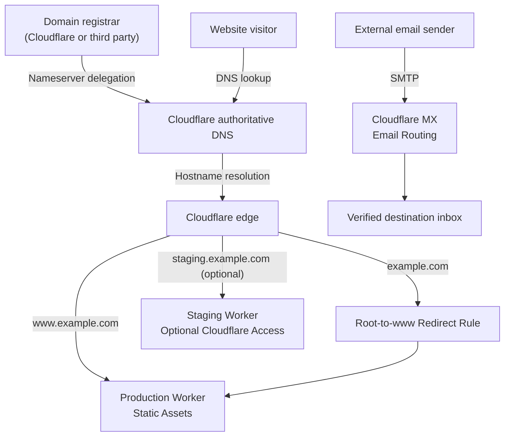

# Cloudflare Domain, Workers Hosting, DNS & Email

**A complete theoretical setup and operations guide** for purchasing or connecting a domain, publishing a static website with Cloudflare Workers, configuring DNS and HTTPS, separating staging from production, and setting up custom-domain email.

**Edition:** 1.0  
**Documentation reviewed:** 10 November 2026  
**Project type:** Documentation / reference guide — not a deployed application

## Read the guide

| Format | Best for | File |
| --- | --- | --- |
| **Markdown** | Reading on GitHub, searching, editing, and viewing Mermaid diagrams | [Cloudflare_Domain_Workers_Email_Setup_Guide.md](./Cloudflare_Domain_Workers_Email_Setup_Guide.md) |
| **PDF** | Offline reading, printing, and sharing a formatted 22-page document | [Cloudflare_Domain_Workers_Email_Setup_Guide.pdf](./Cloudflare_Domain_Workers_Email_Setup_Guide.pdf) |

The Markdown document is the editable reference. The PDF presents the same guide as a formatted publication. Both use **`example.com` as a placeholder**, not as a domain to configure.

## What this guide covers

| Area | Topics |
| --- | --- |
| **Domain registration** | Buying from Cloudflare Registrar or a third-party registrar; registration, nameservers, and domain activation |
| **Cloudflare DNS** | Authoritative DNS, record types, proxy status, DNSSEC, and avoiding conflicting entries |
| **Website hosting** | Workers Static Assets, deployment prerequisites, Wrangler, and Cloudflare Drop as an alternative |
| **Environments** | Independent staging and production Workers, optional staging subdomain, and access protection |
| **Production domain** | Worker Custom Domain for `www.example.com`, apex redirect, and HTTPS |
| **Email receiving** | Cloudflare Email Routing, verified destination mailbox, and four sample email addresses |
| **Email authentication** | SPF, DKIM, DMARC, MX, and DNS ownership responsibilities |
| **Email sending** | Optional Cloudflare Email Sending or an external full-mailbox provider |
| **Operations** | DNS/HTTP/email test procedures, rollout, rollback, troubleshooting, cost considerations, and security checklist |

The full guide includes **20 main sections, four Mermaid diagrams, DNS tables, example commands, acceptance tests, and a deployment checklist**.

## Reference architecture



*Conceptual diagram:* DNS resolves hostnames; Cloudflare's edge handles web requests, while Cloudflare MX servers receive email. DNS does not itself transport web content or email messages.

## End-to-end workflow

```mermaid
flowchart LR
    A["Register or connect domain"] --> B["Activate Cloudflare DNS"]
    B --> C["Prepare static website"]
    C --> D["Deploy and test staging"]
    D --> E["Deploy production"]
    E --> F["Attach www custom domain"]
    F --> G["Configure apex redirect + HTTPS"]
    G --> H["Set up email and DNS authentication"]
    H --> I["Run acceptance checks"]
```



For routine releases, make changes in staging, test them, deploy the approved build to production, verify the live domain, and retain a known-good version for rollback.

## DNS configuration at a glance

The guide's reference configuration uses **`www.example.com` as the canonical website** and redirects the bare domain to `www`.

| Record / configuration | Name | Purpose | Who configures it |
| --- | --- | --- | --- |
| **A** (proxied) | `@` | `192.0.2.0` placeholder for the root-to-`www` redirect | You |
| **Worker Custom Domain** | `www` | Connects the production Worker; Cloudflare provisions the necessary DNS and certificate | Cloudflare |
| **Worker Custom Domain** (optional) | `staging` | Connects the staging Worker | Cloudflare |
| **MX** | `@` | Receives inbound mail through Cloudflare Email Routing | Cloudflare Email Routing onboarding |
| **TXT / SPF** | `@` | Sender-policy information | Cloudflare; merge carefully if another sender is used |
| **TXT / DKIM** | Cloudflare-assigned selector | Email-authentication public key | Cloudflare |
| **TXT / DMARC** | `_dmarc` | Mail-authentication reporting and policy | You |
| **DS / DNSSEC delegation** (optional) | Registrar-side | Establishes the DNSSEC chain of trust | Registrar / Cloudflare process |

**Do not copy generated DNS values from examples.** Actual nameservers, MX priorities, verification records, DKIM keys, and service-specific records must come from the relevant provider's dashboard. Do not add a competing manual `www` A/CNAME when using a Worker Custom Domain.

## Email: important distinction

Cloudflare **Email Routing** forwards incoming messages such as `support@example.com` to an existing verified mailbox. It does **not** create a hosted inbox or provide general-purpose outbound SMTP by itself.

The guide demonstrates four example routing addresses:

- `support@example.com`
- `contact@example.com`
- `info@example.com`
- `admin@example.com`

If you also need to **send** as those addresses or provide individual mailboxes and webmail, follow the guide's separate outbound-email or hosted-mailbox path. Avoid combining incompatible inbound MX configurations at the same hostname.

## How to use this repository

1. Open the [Markdown guide](./Cloudflare_Domain_Workers_Email_Setup_Guide.md) to follow its numbered sections, or use the [PDF guide](./Cloudflare_Domain_Workers_Email_Setup_Guide.pdf) for a print-ready reference.
2. Replace `example.com`, Worker names, and sample inboxes with your actual values when applying the guide to a real account.
3. Choose **one domain-registration path** and **one incoming-email path** before changing DNS.
4. Follow the setup workflow in order: domain and DNS first, then staging and production, then redirects/HTTPS, then email.
5. Record the actual Cloudflare-generated values and complete the guide's DNS, web, and mail acceptance tests before treating the setup as operational.

### Repository structure

```text
.
├── README.md
├── Cloudflare_Domain_Workers_Email_Setup_Guide.md
└── Cloudflare_Domain_Workers_Email_Setup_Guide.pdf
```

Upload all three files into the **repository root** to keep the relative links in this README working. File names are case-sensitive on GitHub.

## Scope and safety

> **Documentation only:** This repository provides a reference procedure, not a ready-to-deploy website or evidence of a working Cloudflare installation. No domain was purchased; no Cloudflare account, DNS record, Worker deployment, SSL certificate, or email delivery was tested on a live domain for the guide.

- Review existing DNS, DNSSEC delegation, and email-provider settings before making changes. Replacing active MX records can interrupt mail delivery.
- Keep API tokens, account credentials, and private keys out of this repository and out of browser-delivered website assets.
- The Cloudflare Free plan can support the reference static-site architecture, but domain registration, optional services, and usage beyond plan limits may incur charges.
- Dashboard labels, feature availability, limits, and service instructions may change. Verify against official documentation before making production changes.

## Maintain the documentation

When updating the guide, revise the Markdown source, verify the Cloudflare instructions and examples, regenerate the PDF, and keep both publications at the same edition. Update the review date and recheck the Markdown/PDF links after changing filenames.

### Official references

- [Cloudflare Registrar](https://developers.cloudflare.com/registrar/get-started/register-domain/)
- [Cloudflare DNS full setup](https://developers.cloudflare.com/dns/zone-setups/full-setup/setup/)
- [Workers Static Assets](https://developers.cloudflare.com/workers/static-assets/get-started/)
- [Workers Custom Domains](https://developers.cloudflare.com/workers/configuration/routing/custom-domains/)
- [Cloudflare Single Redirects](https://developers.cloudflare.com/rules/url-forwarding/single-redirects/)
- [Cloudflare Email Routing](https://developers.cloudflare.com/email-service/get-started/route-emails/)

For additional source references, version-specific details, commands, and troubleshooting, see **Section 20** of the full guide.
